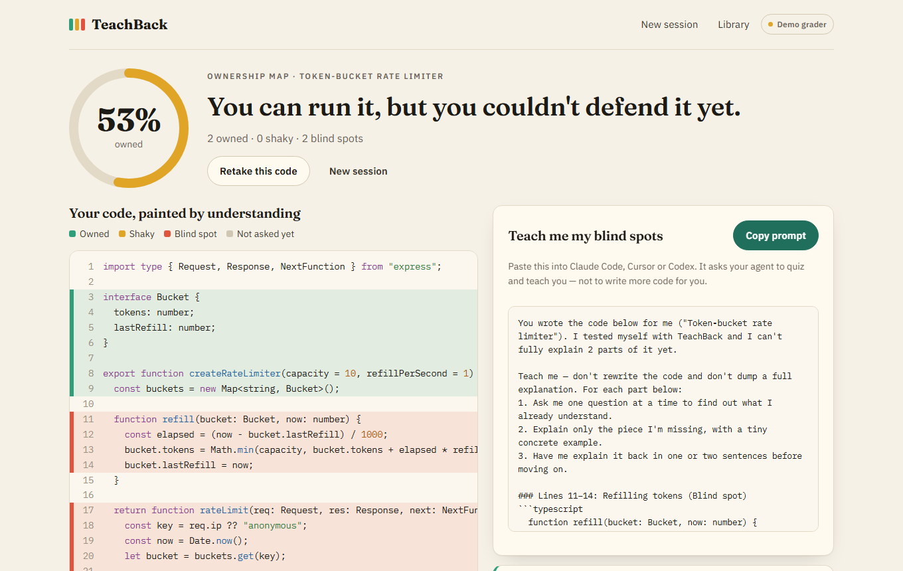
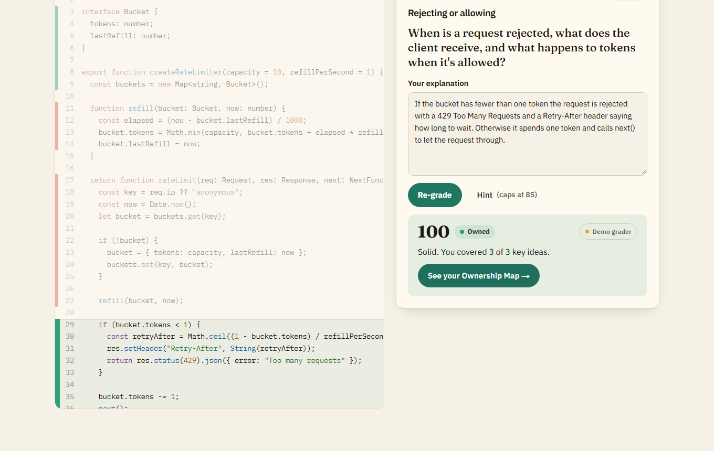
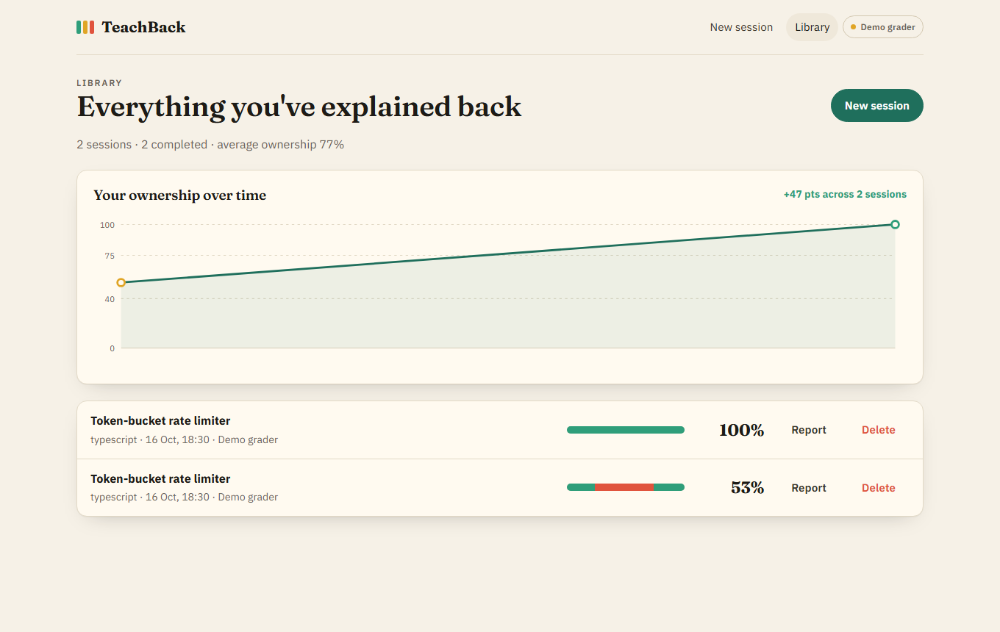
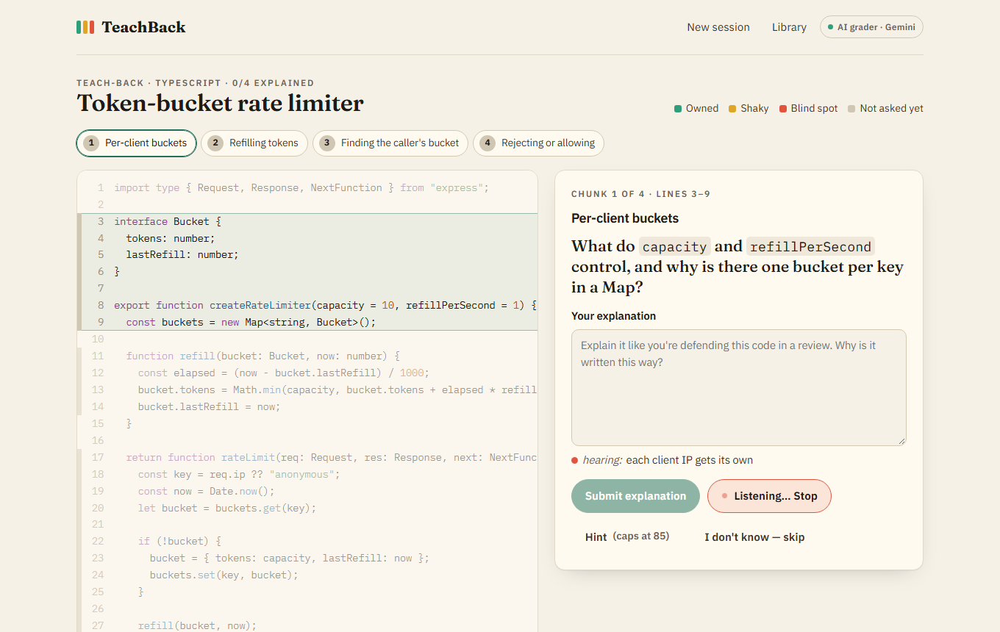

# TeachBack

**Your AI wrote it. Can you explain it?**

TeachBack checks whether you actually understand code an AI coding agent wrote for you. Paste the code, explain each important chunk back in your own words, and get an **Ownership Map**: every line painted *owned*, *shaky* or *blind spot*. Your gaps then become a ready-to-paste prompt that asks your coding agent to **teach you**, instead of writing more code.

It's the *teach-back* method nurses use to confirm a patient understood their instructions, applied to AI pair programming.



## The journey

| Route | What happens |
|---|---|
| `/` | Landing page with a live preview of a session painting itself. |
| `/new` | Paste 5–300 lines of code (or pick one of three AI-written samples), optionally say what it should do, then **Analyze**. |
| `/session/[id]` | The teach-back loop. The code sits on the left with a heat gutter; one review-style question per chunk sits on the right. Type an explanation, or press **Speak** and say it out loud, then submit. You can also take a hint (score capped at 85) or skip. Each verdict repaints its lines straight away. |
| `/session/[id]/report` | The Ownership Map: a weighted score dial, the code painted by understanding, per-chunk feedback with missed concepts, a copyable **"Teach me my blind spots"** prompt, and **Retake**. |
| `/library` | Every session, with mini heat strips, scores, a trend chart of your ownership over time, and delete. |

| Teach-back session | Library and progress |
|---|---|
|  |  |

### Voice answers

Press **Speak** and explain the chunk out loud, like defending it in a code review. Your words appear live as you talk and land in the answer box for you to edit before submitting. This uses the browser's built-in Web Speech API, so it's free and needs no key. It works in Chrome, Edge and Safari; Firefox users can type. In Chrome, the audio is converted to text by Google's speech service.



## How it works

- **Next.js 16 (App Router), React 19, TypeScript.** Pages run in the browser, and sessions are saved in `localStorage`, so there's no account and no database.
- **`/api/analyze`** asks the AI model (**Google Gemini** on the free tier by default, or Claude if you prefer) to split the code into 3–6 meaningful chunks. Each chunk gets a *why/how* question, rubric concepts and a hint. The output is a schema-validated JSON response (a zod schema sent as Gemini `responseJsonSchema`, then validated again on the server), and the line ranges are repaired server-side so the UI can trust them.
- **`/api/grade`** asks the model to grade one explanation against that chunk's rubric. It judges meaning, not vocabulary, and returns a 0–100 score, coaching feedback and missed concepts. The learner's text is fenced off and treated only as an answer, never as instructions.
- **Demo grader:** without an API key, the same routes answer with an offline keyword-matching grader and curated sample chunks. The nav badge and every verdict say **"Demo grader"**, so nothing pretends to be AI.
- The API key stays server-side. Requests use server-side refusal fallback, and errors map to friendly messages with *Try again* and *Use demo grader*.

```
browser ──/new──▶ POST /api/analyze ──▶ Gemini (chunks + questions) ──▶ session saved in localStorage
        ──answer─▶ POST /api/grade   ──▶ Gemini (score + feedback)  ──▶ heat gutter repaints
        ──report─▶ ownershipScore() + blindSpotPrompt()  (pure functions in lib/)
```

## Run it

Requires Node.js 20+.

```bash
npm install
npm run dev          # http://localhost:3000
```

### Free AI grading with Gemini

1. Go to [Google AI Studio](https://aistudio.google.com/apikey), sign in with a Google account, and click **Create API key**. It's free, and no credit card is needed.
2. Copy `.env.example` to `.env.local` and paste the key after `GEMINI_API_KEY=`.
3. Restart `npm run dev`. The nav badge changes to **AI grader · Gemini**.

The free tier allows roughly 10 requests a minute, which is plenty: a session makes one request per answer. Google may use free-tier prompts to improve its products, so don't paste secrets. `GEMINI_MODEL` sets the first model tried (default `gemini-3.5-flash-lite`, the free-tier model that stayed available under load). If a model is overloaded, TeachBack automatically falls back to other Flash models. If you'd rather use Claude, set `ANTHROPIC_API_KEY` instead. Without any key, the app runs end to end in labelled demo mode.

### Checks

```bash
npm test             # unit tests: scoring, demo grader, chunk repair, prompt, highlighter
npm run typecheck
npm run build && npm start
npm run smoke        # API + route smoke test against a running server (BASE_URL, default :3000)
npm run e2e          # Playwright walk-through of the whole journey; screenshots to docs/screenshots
npm run e2e:voice    # voice answers with a simulated microphone, plus the unsupported-browser fallback
                     # (first time: npx playwright install chromium)
```

## Built with the Devpost Learn Skill Pack

This project was planned and built with the [Devpost Learn skill pack](https://github.com/challengepost/learn-ai-basics) for [Build With AI: Basics](https://learn-ai-basics.devpost.com/). The planning documents it produced are in [`devpost/`](devpost/):

- [`scope.md`](devpost/scope.md): the kernel, the user, and the proof-of-concept boundary
- [`prd.md`](devpost/prd.md): the journey, behaviours, acceptance criteria and states
- [`spec.md`](devpost/spec.md): stack, components, data model and failure modes
- [`checklist.md`](devpost/checklist.md): the slice-by-slice build plan, with revisions

## Project layout

```
app/            routes: / · /new · /session/[id] · /session/[id]/report · /library · /api/{analyze,grade,status}
components/     CodeHeat (heat-painted code), SessionView, VoiceButton, ReportView, LibraryView, ScoreDial, TrendChart, …
lib/            ai.ts (prompts), llm.ts (Gemini/Claude providers), speech.ts (Web Speech API), demo.ts (offline grader), samples.ts, scoring.ts, prompt.ts, session.ts, storage.ts
scripts/        smoke.ts, e2e.ts
devpost/        planning docs from the skill pack
```
